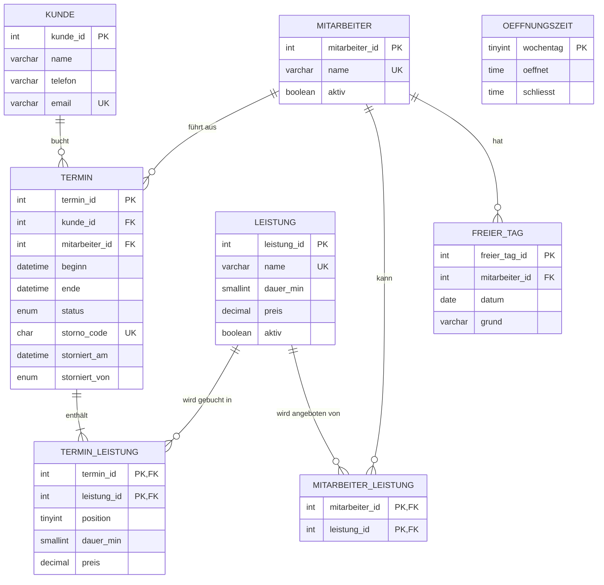

# Schnittpunkt – Online-Terminbuchung

Fullstack-Anwendung für den Friseursalon Schnittpunkt: Kundinnen und Kunden buchen online
einen Termin (Leistung, Person oder „egal“, Datum, freie Uhrzeit), stornieren ihn per Code,
und das Team verwaltet im passwortgeschützten Salon-Bereich Tagesübersicht, Leistungen,
freie Tage und eine Auswertung.

| Teil | Technik |
|---|---|
| Frontend | HTML, CSS, JavaScript ohne Framework (ES-Module, `fetch`) |
| Backend | Node.js mit Express 5, REST-API, ES-Module |
| Datenbank | MySQL 8, Zugriff über `mysql2/promise` (Pool, Prepared Statements) |

Weitere Dokumente:

* [docs/anforderungen.md](docs/anforderungen.md) – Anforderungsliste mit Fundstellen im Protokoll, satzweise Auswertung, offene Fragen
* [docs/architektur.md](docs/architektur.md) – Architekturentscheidungen mit Begründung, verworfenen Alternativen und bekannten Grenzen
* [docs/sequenzdiagramme.md](docs/sequenzdiagramme.md) – Sequenzdiagramme der wichtigsten Abläufe
* [docs/verfuegbarkeit.md](docs/verfuegbarkeit.md) – wie die freien Uhrzeiten der Buchungsseite berechnet werden, mit Rechenbeispiel
* [docs/testfaelle.md](docs/testfaelle.md) – Beschreibung aller Testfälle mit Testdaten, erwarteten Ergebnissen und Abdeckung
* [docs/er-diagramm.md](docs/er-diagramm.md) – ER-Diagramm, Beziehungen, Normalisierung
* [db/schema.sql](db/schema.sql) – Schema und Beispieldaten

---

## Installation

Voraussetzungen: **Node.js ≥ 20.11** und **MySQL 8.0** (läuft lokal oder erreichbar).

```bash
# 1. Abhängigkeiten installieren
npm install

# 2. Konfiguration anlegen und Datenbank-Zugangsdaten eintragen
cp .env.example .env          # Windows PowerShell: Copy-Item .env.example .env
#    → in .env DB_USER und DB_PASSWORD anpassen

# 3. Datenbank mit Tabellen und Beispieldaten anlegen
npm run db:init               # alternativ: mysql -u root -p < db/schema.sql
```

> `npm run db:init` löscht eine vorhandene Datenbank `schnittpunkt` und legt sie neu an.

## Start

```bash
npm start            # oder: npm run dev  (Neustart bei Codeänderungen)
```

| Seite | Adresse |
|---|---|
| Termin buchen | http://localhost:3000/ |
| Termin stornieren | http://localhost:3000/storno |
| Salon-Bereich | http://localhost:3000/salon |

### Zugangsdaten und Demo-Daten

* **Salon-Passwort (Demo):** `schnittpunkt-salon`
  Ein eigenes Passwort setzen: `npm run passwort-hash -- "neues Passwort"` und die ausgegebene
  Zeile `SALON_PASSWORT_HASH=…` in `.env` übernehmen. Im Code steht weder das Passwort noch der Hash.
* **Beispieltermine** werden relativ zum Tag des Imports angelegt: am nächsten Dienstag
  (zehn Termine wie im Designvorschlag, einer davon storniert), am Mittwoch danach und in der
  Vorwoche (erledigt, nicht erschienen, storniert – für die Auswertung).
* **Demo-Stornocode:** `00000000-0000-4000-8000-000000000001` (Färben bei Mara am nächsten Dienstag, 9 Uhr).
  Ist der Termin weniger als 24 Stunden entfernt, zeigt die Stornoseite den Hinweis auf die Frist.
* **Bestätigungs-E-Mail:** erscheint in der Server-Konsole. Mit `SMTP_HOST` usw. in `.env` wird sie
  wirklich verschickt.

## Tests

```bash
npm test
```

* `tests/regeln.test.js` – Unit-Tests für Zeitrechnung, Buchungsregeln und Validierung.
* `tests/api.test.js` – Integrationstests aller wichtigen Routen. Sie legen eine **eigene
  Datenbank `schnittpunkt_test`** an (die Entwicklungsdaten bleiben unberührt), starten den
  Server auf Port 3999 und stellen die Uhr fest auf „Montag 10:00 vor dem ersten Beispieltag“.
  Geprüft werden u. a. Doppelbuchungen, **12 gleichzeitige Buchungen auf denselben Platz
  (genau eine gewinnt)**, „egal“-Zuteilung, Stornofrist, Salon-Login, Preis-Historie und freie Tage.
  Wer ein anderes Salon-Passwort gesetzt hat, gibt es mit `TEST_SALON_PASSWORT` an.

Für manuelle Tests mit `curl`:

```bash
curl "http://localhost:3000/api/verfuegbarkeit?datum=2026-11-17&leistungen=1,5&mitarbeiter=egal"

curl -X POST http://localhost:3000/api/termine -H "Content-Type: application/json" \
  -d '{"leistungIds":[1,5],"mitarbeiterId":"egal","datum":"2026-11-18","uhrzeit":"10:30",
       "name":"Erika Muster","telefon":"0151 1234567","email":"erika@example.org"}'
```

---

## Projektstruktur

```
db/schema.sql                 Schema, Constraints, Beispieldaten, Beispielabfragen
docs/                         Anforderungsliste, ER-Diagramm
scripts/db-init.js            spielt db/schema.sql mit den Daten aus .env ein
scripts/passwort-hash.js      erzeugt den scrypt-Hash für das Salon-Passwort
src/
  server.js                   Express-App, Sicherheits-Header, statisches Frontend
  config.js                   liest .env, Buchungsregeln als Konstanten
  db.js                       Connection-Pool, Transaktions-Hilfe
  routes/oeffentlich.js       Routen für Buchung und Storno
  routes/salon.js             Routen für den Salon-Bereich
  services/regeln.js          Buchungsregeln (für Anzeige UND Buchung gemeinsam)
  services/verfuegbarkeit.js  Berechnung freier Zeiten
  services/buchung.js         Buchen (Transaktion + Sperre), Storno per Code
  services/salon.js           Tagesübersicht, Status, Leistungen, freie Tage, Auswertung
  services/stammdaten.js      gemeinsame Abfragen (Leistungen, Personen, Öffnungszeiten)
  services/mail.js            Bestätigungs-E-Mail (Konsole oder SMTP)
  middleware/auth.js          Passwortprüfung, Sitzungs-Cookie, Login-Sperre
  middleware/fehlerbehandlung.js  einheitliche JSON-Fehler
  utils/validierung.js        serverseitige Prüfung aller Eingaben
  utils/zeit.js               Datums-/Zeitformat und -rechnung
  utils/fehler.js             Fehler mit HTTP-Status und Meldung
public/
  index.html, storno.html, salon.html
  css/style.css
  js/api.js                   eine Funktion pro REST-Route (fetch)
  js/dom.js, js/format.js     Darstellungs- und Formatierungshilfen
  js/buchung.js, js/storno.js, js/salon*.js   Logik der Seiten
tests/                        node:test – Unit- und API-Tests
```

## REST-API

Alle Antworten sind JSON. Fehler haben immer die Form `{ "fehler": "verständliche Meldung", "code": "…" }`.
Datum: `YYYY-MM-DD`, Uhrzeit: `HH:MM`, lokale Salonzeit.

| Methode | Route | Zweck | Erfolg | Fehler |
|---|---|---|---|---|
| GET | `/api/leistungen` | aktive Leistungen (Name, Dauer, Preis) | 200 | |
| GET | `/api/mitarbeiter` | aktive Personen mit ihren Leistungs-IDs | 200 | |
| GET | `/api/einstellungen` | Öffnungszeiten, heute, letztes buchbares Datum | 200 | |
| GET | `/api/verfuegbarkeit?datum=&leistungen=1,5&mitarbeiter=2\|egal` | freie Startzeiten (nur Uhrzeiten) | 200 | 400, 422 |
| POST | `/api/termine` | Termin buchen | 201 + `Location` | 400, 409 belegt, 422 Regel |
| GET | `/api/termine/code/:code` | eigenen Termin über Stornocode anzeigen | 200 | 400, 404 |
| POST | `/api/termine/code/:code/stornierung` | eigenen Termin stornieren | 200 | 404, 409 schon storniert, 422 Frist |
| POST | `/api/salon/login` | Anmeldung `{ passwort }` | 204 + Cookie | 401, 429 |
| POST | `/api/salon/logout` | Abmelden | 204 | |
| GET | `/api/salon/sitzung` | Anmeldung prüfen | 204 | 401 |
| GET | `/api/salon/termine?datum=` oder `?von=&bis=` | Termine mit Kundendaten, Personen, freie Tage | 200 | 400, 401 |
| PATCH | `/api/salon/termine/:id` | Status setzen `{ status }` | 204 | 400, 404, 409, 422 |
| GET | `/api/salon/mitarbeiter` | alle Personen | 200 | 401 |
| GET | `/api/salon/leistungen` | alle Leistungen inkl. inaktiver | 200 | 401 |
| POST | `/api/salon/leistungen` | Leistung anlegen | 201 | 400, 409 Name vergeben |
| PUT | `/api/salon/leistungen/:id` | Leistung ändern/deaktivieren | 204 | 400, 404, 409 |
| GET | `/api/salon/freie-tage?von=&bis=` | freie Tage | 200 | 401 |
| POST | `/api/salon/freie-tage` | freien Tag eintragen | 201 | 400, 409 |
| DELETE | `/api/salon/freie-tage/:id` | freien Tag entfernen | 204 | 404 |
| GET | `/api/salon/auswertung?von=&bis=` | Termine pro Woche, Umsatz je Leistung | 200 | 400, 401 |

**Statuscodes:** 400 = Eingabe hat falsches Format, 401 = nicht angemeldet, 404 = nicht gefunden,
409 = Konflikt mit dem aktuellen Zustand (Zeit inzwischen belegt, Termin schon storniert, Name doppelt),
422 = Eingabe ist formal richtig, verstößt aber gegen eine Buchungsregel (Öffnungszeit, Vorlauf, Stornofrist …),
429 = zu viele Fehlversuche beim Login.

Die Stornierung ist bewusst `POST …/stornierung` und kein `DELETE`: Der Termin wird nicht gelöscht,
sondern bekommt den Status `storniert` (Protokoll: „Die Termine will ich nicht löschen“).

## ER-Diagramm



Details zu Constraints, Kardinalitäten und Normalisierung: [docs/er-diagramm.md](docs/er-diagramm.md).

---

## Annahmen und Entscheidungen

Wo das Protokoll etwas offen ließ, habe ich folgende Annahmen getroffen (ausführlich mit
Begründung in [docs/anforderungen.md](docs/anforderungen.md#offene-fragen-und-getroffene-annahmen)):

| Offener Punkt | Entscheidung | Begründung |
|---|---|---|
| Woran wird ein wiederkehrender Kunde erkannt? | An der **E-Mail-Adresse** (`UNIQUE`, klein geschrieben). Name und Telefon werden bei jeder Buchung aktualisiert. | Telefonnummern werden unterschiedlich geschrieben und in Familien geteilt; E-Mail ist eindeutiger. |
| „nicht alles neu tippen“ – aber „niemand darf sehen, wer sonst gebucht hat“ | Kontaktdaten werden **nur im eigenen Browser** (`localStorage`, abwählbar) vorausgefüllt, nicht vom Server nachgeschlagen. | Ein Nachschlagen per E-Mail würde Name und Telefonnummer fremder Kunden preisgeben. |
| Preisänderung bei gebuchten Terminen | Es gilt der **Preis zum Buchungszeitpunkt**, gespeichert in `termin_leistung.preis` (+ `dauer_min`). | Bewusste Abweichung von der 3. NF: Historische Termine und Umsätze dürfen sich nicht nachträglich ändern. |
| Leistung löschen? | **Nein, deaktivieren** (`aktiv`). Fremdschlüssel aus `termin_leistung` mit `ON DELETE RESTRICT`. | Alte Termine und die Auswertung bleiben vollständig. |
| Wen wählt „egal“? | Unter den freien, passenden Personen die mit den **wenigsten Terminen an diesem Tag**, bei Gleichstand die kleinere ID. | Gleichmäßige Auslastung, nachvollziehbar und deterministisch. |
| Pausen, Feiertage, Urlaub | Keine festen Pausen. Abwesenheiten werden als **freie Tage pro Person** eingetragen (Bonus W-03). Ein freier Tag kann nur eingetragen werden, wenn die Person an dem Tag keine gebuchten Termine hat. | Protokoll nennt nur freie Tage. Kein stilles Verschwinden gebuchter Termine. |
| Mehrere Leistungen in einem Termin | Bis zu **3 Leistungen** nacheinander bei **einer** Person; Dauer und Preis werden addiert; nur Personen, die **alle** gewählten Leistungen anbieten, sind wählbar. | „Schnitt und Bart in einem Termin“ – die Kundschaft bleibt auf dem Stuhl. |
| „3 Monate im Voraus“ | Bis einschließlich zum gleichen Kalendertag drei Monate später (am Monatsende gekürzt: 30.11. → 28.02.). | Eindeutig prüfbar. |
| „2 Stunden vorher“ / „24 Stunden vorher“ | Gemessen vom aktuellen Zeitpunkt bis zum **Beginn** des Termins. Genau 2 h bzw. 24 h sind noch erlaubt. | |
| Dauer, die nicht auf 15 Minuten aufgeht (Kinderschnitt 20 Min) | **Beginn** liegt immer im 15-Minuten-Raster, das **Ende** ergibt sich exakt aus der Dauer (z. B. 9:00–9:20). Die Person ist danach ab 9:30 wieder buchbar (nächster Rasterpunkt). | Protokoll: „Gebucht wird im Viertelstundentakt“ – betrifft die Startzeiten. |
| Statuswechsel im Salon | `gebucht → erledigt / nicht erschienen / storniert`; Fehlklicks bei „erledigt“/„nicht erschienen“ können zurückgesetzt werden. **„storniert“ ist endgültig**, weil der Platz inzwischen neu vergeben sein kann. „Erledigt“ ist erst ab dem Termintag möglich. | |
| Termin ändern | Nicht vorgesehen: stornieren und neu buchen (bzw. anrufen). | Protokoll erwähnt nur Stornieren. |
| Zeitzone | Alle Zeiten sind **lokale Salonzeit** (`Europe/Berlin`), gespeichert als `DATETIME` ohne Zeitzone. Gerechnet wird mit Wandzeit; die Zeitumstellung (So 2–3 Uhr) betrifft keine Frist, weil So/Mo geschlossen ist. | Ein durchgehendes Format: `YYYY-MM-DD`, `HH:MM`, `YYYY-MM-DD HH:MM:SS`. |
| Instagram-Link (W-06) | Nicht umgesetzt – kein Account-Name bekannt, Randbemerkung ohne Auftrag. | |
| Kaffeemaschine | Nicht übernommen (kein Bezug zur Anwendung). | |

## Schutz vor Doppelbuchungen

1. Die freien Zeiten werden **im Backend** berechnet; das Frontend bekommt nur `["09:00", "09:15", …]`.
2. Beim Buchen werden alle Regeln **erneut** geprüft (dieselbe Funktion `regeln.zeitVerstoss`).
3. Prüfen und Speichern laufen in **einer Transaktion**. Die Zeilen der infrage kommenden
   Mitarbeiter werden mit `SELECT … FOR UPDATE` (in fester Reihenfolge, gegen Deadlocks) gesperrt.
   Eine gleichzeitige zweite Buchung für dieselbe Person wartet, bis die erste fertig ist, und sieht
   deren Termin dann bei ihrer Überschneidungsprüfung (`READ COMMITTED`).
4. Überschneidung: `beginn_neu < ende_alt AND ende_neu > beginn_alt`; stornierte Termine zählen nicht.

Der Test „parallele Buchungen“ schickt 12 gleichzeitige Anfragen auf denselben Platz – genau eine bekommt 201, alle anderen 409.

## Sicherheit

* **Prepared Statements:** alle Abfragen mit `?`-Platzhaltern (`pool.execute`). Für `IN (…)`-Listen
  werden nur die Platzhalter erzeugt, die Werte bleiben Parameter.
* **Serverseitige Validierung** jeder Eingabe (`src/utils/validierung.js`), Body-Größe begrenzt (20 kB).
* **Salon-Passwort** nur als **scrypt-Hash** in `.env`; Vergleich in konstanter Zeit; nach 5 Fehlversuchen
  15 Minuten Sperre pro IP. Sitzung als zufällige ID in einem `HttpOnly`-, `SameSite=Strict`-Cookie,
  das nur für `/api/salon` gilt.
* **Stornocode:** `crypto.randomUUID()` (122 Bit Zufall) – nicht erratbar. Die Stornoseite zeigt keine Kundendaten.
* **Keine fremden Daten** auf öffentlichen Routen; Kundendaten nur im Salon-Bereich.
* **XSS:** Das Frontend setzt Inhalte nur mit `textContent`; strenge Content-Security-Policy über `helmet`
  (nur eigene Skripte/Styles, kein Inline-Code).
* `.env` ist in `.gitignore`; `.env.example` enthält keine echten Zugangsdaten.

Bekannte Grenzen: Sitzungen liegen im Arbeitsspeicher (nach einem Neustart neu anmelden) und
die Login-Sperre gilt pro Server-Prozess – für einen Salon mit einem Server ausreichend.

## Umgesetzte Bonusfunktionen

* **Bestätigungs-E-Mail** – Konsolenausgabe, echter Versand per SMTP konfigurierbar
* **Mehrere Leistungen in einem Termin** (z. B. Herrenschnitt + Bartpflege)
* **Freie Tage pro Mitarbeiter**, werden bei Verfügbarkeit, Buchung und „egal“ berücksichtigt
* **Wochenansicht** im Salon-Bereich
* **Status „nicht erschienen“** und **Auswertung** (Termine pro Woche, Umsatz je Leistung)
* **Responsive Darstellung** für Smartphones
