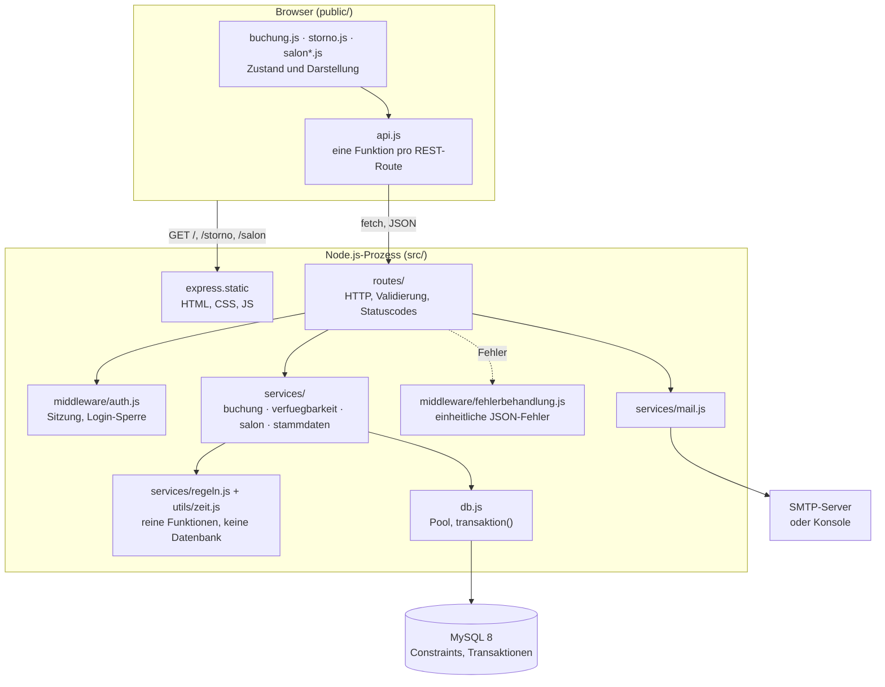

# Architektur – Entscheidungen und ihre Begründung

Dieses Dokument verteidigt die Architektur der Terminbuchung für den Friseursalon Schnittpunkt.
Zu jeder Entscheidung steht, was ich gewählt habe, warum, welche Alternative ich verworfen habe
und welchen Preis die Entscheidung hat. Die Abläufe dazu zeigt
[sequenzdiagramme.md](sequenzdiagramme.md), das Datenmodell [er-diagramm.md](er-diagramm.md).

## Kurzfassung

Die Anwendung ist ein **Monolith in drei Schichten**: ein Express-Prozess liefert das statische
Frontend aus und beantwortet die REST-API, dahinter steht eine MySQL-Datenbank.

Die Architektur folgt drei Leitlinien:

1. **Der Server entscheidet, der Browser zeigt an.** Freie Zeiten, Buchungsregeln und Preise
   entstehen im Backend. Das Frontend kann nichts durchsetzen und muss es deshalb auch nicht.
2. **Jede Regel steht an genau einer Stelle.** Dieselbe Funktion bestimmt, welche Zeit angezeigt
   wird und welche Zeit gebucht werden darf.
3. **So wenig Teile wie möglich.** Ein Salon mit einer Handvoll Mitarbeitern braucht einen
   Prozess und eine Datenbank, keine verteilte Plattform.

## Überblick

Abhängigkeiten zeigen nur nach unten: Routen kennen Dienste, Dienste kennen Regeln und die
Datenbank. Kein Dienst kennt `req` oder `res`, keine Route enthält SQL.

---

## 1. Ein Prozess für Frontend und API

**Entscheidung.** `src/server.js` liefert `public/` aus und hängt die API unter `/api` ein.

**Begründung.**

* Gleiche Herkunft für Seite und API: kein CORS, und das Sitzungs-Cookie kann `SameSite=Strict`
  sein. Damit entfällt eine ganze Klasse von Konfigurations- und Sicherheitsfehlern.
* Die Content-Security-Policy kann maximal streng sein (`'self'` für alles, kein Inline-Code),
  weil nichts von fremden Adressen geladen wird.
* Ein Start, ein Port, ein Deployment. Wer den Salon betreut, muss einen Dienst am Leben halten.

**Verworfen.** Getrenntes Frontend (eigener Dev-Server oder CDN) plus API-Server. Das lohnt sich,
wenn Teams getrennt ausliefern oder das Frontend einen Build-Schritt braucht. Beides trifft hier
nicht zu.

**Preis.** Frontend und API skalieren nur gemeinsam. Bei der Last eines Salons spielt das keine
Rolle; statische Dateien ließen sich später ohne Codeänderung vor einen Proxy legen.

## 2. Schichten im Backend: Route → Dienst → Regel

**Entscheidung.** Drei Ebenen mit klarer Zuständigkeit:

| Ebene | Aufgabe | kennt |
|---|---|---|
| `routes/` | Eingabe aus der Anfrage lesen, validieren, Dienst aufrufen, Statuscode setzen | HTTP |
| `services/` | Fachlogik, SQL, Transaktionen | Datenbank, Regeln |
| `services/regeln.js`, `utils/zeit.js` | Rechnen und Entscheiden ohne Ein-/Ausgabe | nichts |

**Begründung.**

* **Testbarkeit.** `regeln.js` und `zeit.js` sind reine Funktionen. `tests/regeln.test.js` prüft
  Öffnungszeit, Vorlauf, Raster und Überschneidung ohne Datenbank und ohne Server.
* **Lesbarkeit.** Eine Route ist wenige Zeilen lang und liest sich wie die API-Tabelle in der
  README. Wer wissen will, *was* beim Buchen passiert, liest `services/buchung.js` von oben nach
  unten.
* **Fehler entstehen dort, wo das Wissen ist.** Dienste werfen `fehler.konflikt(…)` oder
  `fehler.regel(…)` mit Meldung und Statuscode. Die Routen müssen nichts übersetzen, und
  `fehlerbehandlung.js` macht daraus an einer Stelle JSON.

**Verworfen.**

* *Repository-Schicht oder ORM.* Bei acht Tabellen wäre das eine zusätzliche Ebene ohne eigene
  Aufgabe. Wichtiger: Die Korrektheit der Buchung hängt an `SELECT … FOR UPDATE`, der
  Sperr-Reihenfolge und `INSERT … ON DUPLICATE KEY UPDATE`. Dieses SQL soll sichtbar im Dienst
  stehen und nicht hinter einer Abstraktion verschwinden.
* *Klassen und Dependency Injection.* Die Dienste sind ES-Module mit Funktionen. Der Zustand
  liegt in der Datenbank, nicht in Objekten. Die einzige nötige „Injektion“ ist die Verbindung:
  Funktionen wie `ladeKandidaten(db, …)` nehmen wahlweise den Pool oder die Verbindung einer
  laufenden Transaktion entgegen.

**Preis.** SQL steht als Text im Code, ohne Typprüfung. Abgefangen wird das durch die
Integrationstests, die jede wichtige Route gegen eine echte MySQL-Datenbank ausführen.

## 3. Eine Regel, zwei Verwendungen

**Entscheidung.** `regeln.zeitVerstoss()` und `regeln.istFrei()` werden sowohl von
`verfuegbarkeit.freieZeiten()` (Anzeige) als auch von `buchung.bucheTermin()` (Buchung) benutzt.

**Begründung.** Der unangenehmste Fehler einer Terminbuchung ist, eine Zeit anzuzeigen, die sich
dann nicht buchen lässt, oder umgekehrt eine Zeit anzunehmen, die nie angeboten wurde. Wenn beide
Wege dieselbe Funktion aufrufen, können sie nicht auseinanderlaufen. Die Zahlenwerte dazu
(15 Minuten Raster, 2 Stunden Vorlauf, 3 Monate, 24 Stunden Stornofrist) stehen einmal in
`config.js`.

**Verworfen.** Regeln zusätzlich im Frontend nachbauen, um Anfragen zu sparen. Das wäre eine
zweite Quelle der Wahrheit in einer zweiten Laufzeit mit einer zweiten Uhr. Das Frontend fragt
stattdessen `/api/einstellungen` ab und nutzt die Werte nur für die Bedienung (Datumsgrenzen,
geschlossene Tage überspringen).

## 4. Verfügbarkeit wird im Backend berechnet

**Entscheidung.** `GET /api/verfuegbarkeit` liefert nur eine Liste von Uhrzeiten wie
`["09:00", "09:15"]`, keine Termine.

**Begründung.**

* **Datenschutz als Struktur, nicht als Disziplin.** Die Anforderung „niemand darf sehen, wer
  sonst gebucht hat“ ist erfüllt, weil belegte Zeiträume den Server nie verlassen. Bei „egal“
  ist nicht einmal erkennbar, welche Person frei ist.
* **Eine Uhr.** „Mindestens zwei Stunden vorher“ wird gegen die Serverzeit in Salon-Zeitzone
  geprüft. Eine falsch gestellte Uhr im Browser ändert nichts.

**Preis.** Jede Änderung der Auswahl kostet eine Anfrage. `buchung.js` verwirft veraltete
Antworten über einen Anfragezähler, damit eine langsame alte Antwort keine neuere überschreibt.

## 5. Doppelbuchungen: pessimistische Sperre auf der Mitarbeiter-Zeile

Das ist die wichtigste Entscheidung der Anwendung.

**Entscheidung.** `bucheTermin()` läuft in einer Transaktion (`READ COMMITTED`). Vor der
Überschneidungsprüfung werden die Zeilen aller infrage kommenden Mitarbeiter mit
`SELECT … FOR UPDATE` gesperrt, aufsteigend nach ID. Erst danach werden die Belegungen gelesen,
die Person gewählt und der Termin gespeichert.

**Begründung.**

* **Die Mitarbeiter-Zeile ist der natürliche Mutex.** Zwei Termine stören sich nur, wenn sie
  dieselbe Person betreffen. Die Sperre serialisiert genau diese Fälle; Buchungen für andere
  Personen laufen ungehindert parallel.
* **Sperren, dann lesen.** Unter `READ COMMITTED` sieht jede Abfrage den zuletzt bestätigten
  Stand. Die wartende zweite Buchung liest die Belegungen erst, nachdem die erste committet hat,
  und findet deren Termin. Unter dem MySQL-Standard `REPEATABLE READ` hinge das davon ab, wann
  der Snapshot der Transaktion entstanden ist. Das explizite Isolationslevel in `db.js` macht
  das Verhalten eindeutig.
* **Feste Reihenfolge verhindert Deadlocks.** Bei „egal“ werden mehrere Zeilen gesperrt. Weil
  alle Transaktionen in derselben Reihenfolge sperren, kann keine auf eine andere warten, die
  ihrerseits auf sie wartet.
* **Auch „egal“ ist damit korrekt.** Die Auswahl „Person mit den wenigsten Terminen“ geschieht
  unter der Sperre, also auf dem Stand, der auch gespeichert wird.

**Verworfen.**

| Alternative | Warum nicht |
|---|---|
| Nur prüfen, dann einfügen (ohne Sperre) | Klassische Lücke: zwei Anfragen prüfen gleichzeitig, beide sehen „frei“, beide fügen ein. |
| `UNIQUE (mitarbeiter_id, beginn)` | Fängt nur identische Startzeiten ab. 9:00–10:00 und 9:30–10:30 überschneiden sich und hätten verschiedene Schlüssel. |
| Eine Zeile pro 15-Minuten-Slot mit `UNIQUE` | Würde Überschneidungen in der Datenbank erzwingen, aber das Modell verbiegen: Ein Kinderschnitt mit 20 Minuten endet nicht auf dem Raster, und Stornos müssten Slots wieder freigeben. |
| Optimistische Sperre mit Versionsnummer und Wiederholung | Braucht Wiederholungslogik. Bei einem umkämpften Platz ist das Ergebnis dasselbe (einer gewinnt), nur umständlicher. |
| `SERIALIZABLE` | Führt unter Last zu Deadlocks und Abbrüchen, die wiederholt werden müssten. |
| Sperre im Node-Prozess (Mutex im Speicher) | Hält nur, solange es genau einen Prozess gibt. Die Datenbanksperre gilt auch für einen zweiten Prozess. |
| Exclusion-Constraint | Gibt es in PostgreSQL, nicht in MySQL. MySQL war vorgegeben. |

**Nachweis.** `tests/api.test.js` schickt zwölf gleichzeitige Buchungen auf denselben Platz und
erwartet genau einmal 201 und elfmal 409.

**Preis.** Die Überschneidungsfreiheit erzwingt die Anwendung, nicht das Schema. Wer mit einem
SQL-Client direkt in `termin` schreibt, kann sie umgehen. Die Datenbank sichert trotzdem alles,
was sich deklarativ sichern lässt (siehe Abschnitt 6).

## 6. Die Datenbank als zweite Verteidigungslinie

**Entscheidung.** Regeln, die sich als Constraint ausdrücken lassen, stehen zusätzlich im Schema:
`UNIQUE` auf E-Mail, Stornocode, Leistungsname und (Mitarbeiter, Datum) bei freien Tagen;
`CHECK` für `ende > beginn`, Dauer, Preis und die Konsistenz der Storno-Felder; Fremdschlüssel
mit `ON DELETE RESTRICT`.

**Begründung.** Die Anwendung prüft zuerst und liefert verständliche Meldungen. Das Schema fängt,
was durchrutscht. Zwei Stellen nutzen das gezielt: Ein doppelter Leistungsname und ein doppelter
freier Tag werden über `ER_DUP_ENTRY` erkannt und als 409 gemeldet, ohne dass vorher eine eigene
Abfrage nötig wäre, die wieder eine Lücke hätte.

**Bewusste Abweichung von der dritten Normalform.** `termin_leistung` speichert Preis und Dauer
zum Buchungszeitpunkt. Eine Preisänderung darf vergangene Umsätze nicht umschreiben. Aus
demselben Grund werden Leistungen deaktiviert statt gelöscht und Termine storniert statt
gelöscht: Die Auswertung bleibt vollständig.

## 7. Zeit als Text und als Minutenzahl

**Entscheidung.** Datum und Uhrzeit sind durchgehend lokale Salonzeit: `DATETIME` ohne Zeitzone
in der Datenbank, `dateStrings: true` im Treiber, Rechnen mit ganzen Minuten in `utils/zeit.js`.

**Begründung.** Ein Friseurtermin um 9:00 ist um 9:00 Wandzeit, egal wo Server oder Browser
stehen. JavaScript-`Date` rechnet stillschweigend in die Zeitzone des Prozesses um; ein Server in
UTC würde Termine um eine oder zwei Stunden verschieben. Indem die Datenbank Text liefert und die
Anwendung mit Minuten rechnet, gibt es keine Stelle, an der eine Umrechnung passieren könnte.
`zeit.jetzt()` ist die einzige Funktion, die die Uhr liest, und damit auch die einzige Stelle,
an der die Tests die Zeit festhalten.

**Preis.** Die Anwendung kennt genau eine Zeitzone. Für einen Salon mit einem Standort ist das
die richtige Vereinfachung; für eine Kette in mehreren Zeitzonen müsste man es ändern.

## 8. Frontend ohne Framework und ohne Build

**Entscheidung.** Drei HTML-Seiten, ES-Module direkt im Browser, `fetch`. Jede Seite hält ein
Zustandsobjekt und zeichnet sich nach Änderungen neu. `api.js` enthält genau eine Funktion pro
Route, `dom.js` baut Elemente über `textContent`.

**Begründung.**

* **Umfang.** Die Oberfläche besteht aus einem Buchungsformular, einer Stornoseite und einem
  Verwaltungsbereich. Dafür trägt ein Zustandsobjekt mit einer Zeichenfunktion.
* **Kein Build, keine Frontend-Abhängigkeiten.** Was im Repository steht, läuft im Browser. Es
  gibt nichts zu aktualisieren und nichts, was in zwei Jahren nicht mehr baut.
* **Sicherheit durch Bauweise.** Weil Inhalte nur über `textContent` gesetzt werden, gibt es
  keinen Weg, über den ein Kundenname als HTML im Salon-Bereich landet. Die CSP verbietet
  zusätzlich jeden Inline-Code.
* **Eine API-Schicht.** Fehler kommen überall als `Error` mit `message`, `status` und `code` an.
  Die Seiten zeigen die Meldung des Servers an und reagieren auf den Status (401 → Anmeldung,
  409/422 → freie Zeiten neu laden).

**Verworfen.** React oder Vue mit Bundler. Ab deutlich mehr Ansichten mit geteiltem Zustand wäre
das die bessere Wahl; hier wäre das Werkzeug größer als die Aufgabe.

**Preis.** Neuzeichnen ganzer Bereiche statt gezielter Aktualisierung, und Zustandslogik von Hand.
Bei wenigen Dutzend Elementen pro Ansicht ist das nicht spürbar.

## 9. Anmeldung: ein Passwort, Sitzung im Speicher

**Entscheidung.** Ein gemeinsames Salon-Passwort als scrypt-Hash in `.env`, Vergleich in
konstanter Zeit, Sitzung als zufällige ID in einem `HttpOnly`-Cookie mit `SameSite=Strict` und
`Path=/api/salon`. Sitzungen und Fehlversuche liegen in `Map`s im Prozess. Kunden haben kein
Konto; ihr Zugang zum eigenen Termin ist der Stornocode (UUID, 122 Bit Zufall).

**Begründung.**

* Die Anforderung nennt einen passwortgeschützten Bereich für das Team, keine Rollen und keine
  einzelnen Benutzer. Eine Benutzertabelle wäre Funktionsumfang ohne Auftrag.
* Ein Cookie statt eines Tokens in `localStorage`: Für JavaScript unsichtbar, also durch XSS
  nicht auslesbar, und durch `SameSite=Strict` von fremden Seiten aus nicht mitsendbar. Deshalb
  braucht es kein CSRF-Token.
* Kunden ohne Konto senken die Hürde beim Buchen. Der Stornocode ist ein Geheimnis, das nur in
  der Bestätigung steht, und die Stornoseite zeigt keine Kontaktdaten.

**Preis.** Nach einem Neustart müssen sich alle neu anmelden, die Login-Sperre gilt pro Prozess,
und es ist nicht nachvollziehbar, *wer* im Team etwas geändert hat. Sobald mehrere Prozesse
laufen sollen, müssen Sitzungen in die Datenbank.

## 10. Fehler und Nebenwirkungen

**Entscheidung.**

* Alle Fehler haben die Form `{ fehler, code }`. Die Statuscodes unterscheiden bewusst zwischen
  400 (Format falsch), 409 (Zustand hat sich geändert) und 422 (Regel verletzt).
* Die Bestätigungs-E-Mail wird **nach** dem Commit und ohne `await` gesendet.

**Begründung.**

* Die Trennung 409/422 ist für das Frontend handlungsrelevant: Bei 409 war die Eingabe richtig,
  aber jemand war schneller, also freie Zeiten neu laden. Deadlock und Sperr-Timeout werden zu
  503 mit der Bitte, es noch einmal zu versuchen. Unerwartete Fehler werden geloggt und nach
  außen neutral gemeldet, ohne SQL-Text.
* Eine E-Mail gehört nicht in eine Datenbanktransaktion. Ein langsamer oder ausgefallener
  Mailserver darf weder die Sperre auf der Mitarbeiter-Zeile verlängern noch eine gültige
  Buchung zurückrollen. Der Stornocode steht zusätzlich in der Antwort und auf der
  Bestätigungsseite, die Buchung ist also auch ohne E-Mail vollständig.

**Preis.** Geht eine E-Mail verloren, wird sie nicht wiederholt; es bleibt bei einem Eintrag im
Log. Verlässlicher Versand bräuchte eine Warteschlange in der Datenbank (Outbox).

---

## Bekannte Grenzen

Eine Verteidigung ist nur glaubwürdig, wenn sie die schwachen Stellen nennt.

| Grenze | Auswirkung | Ausweg |
|---|---|---|
| Sitzungen und Login-Sperre im Arbeitsspeicher | Neustart meldet alle ab; nur ein Prozess möglich | Sitzungstabelle in MySQL |
| Überschneidungsfreiheit nur in der Anwendung | Direkte SQL-Schreibzugriffe können sie umgehen | Eigener DB-Benutzer nur für die Anwendung; Trigger als zusätzliche Sicherung |
| Kandidaten werden vor der Sperre gelesen | Trägt der Salon genau zwischen Kandidatenabfrage und Sperre einen freien Tag ein, kann eine Buchung auf diesem Tag landen. Fenster von Millisekunden, aber vorhanden. | Freie Tage nach dem Sperren noch einmal prüfen |
| Kein Rate-Limit auf öffentlichen Routen | Buchungen und Verfügbarkeitsabfragen lassen sich automatisiert fluten | Rate-Limit pro IP am Proxy oder als Middleware |
| E-Mail ohne Wiederholung | Bestätigung kann verloren gehen | Outbox-Tabelle mit Versand-Job |
| Eine Zeitzone, ein Salon | Nicht mandantenfähig | `salon_id` in den Tabellen, Zeitzone pro Salon |

Keine dieser Grenzen verletzt eine Anforderung aus dem Gespräch. Jede lässt sich beheben, ohne
die Schichten oder das Datenmodell umzubauen. Das ist der eigentliche Test für die Architektur:
Sie ist für die heutige Aufgabe so klein wie möglich und steht den naheliegenden nächsten
Schritten nicht im Weg.
