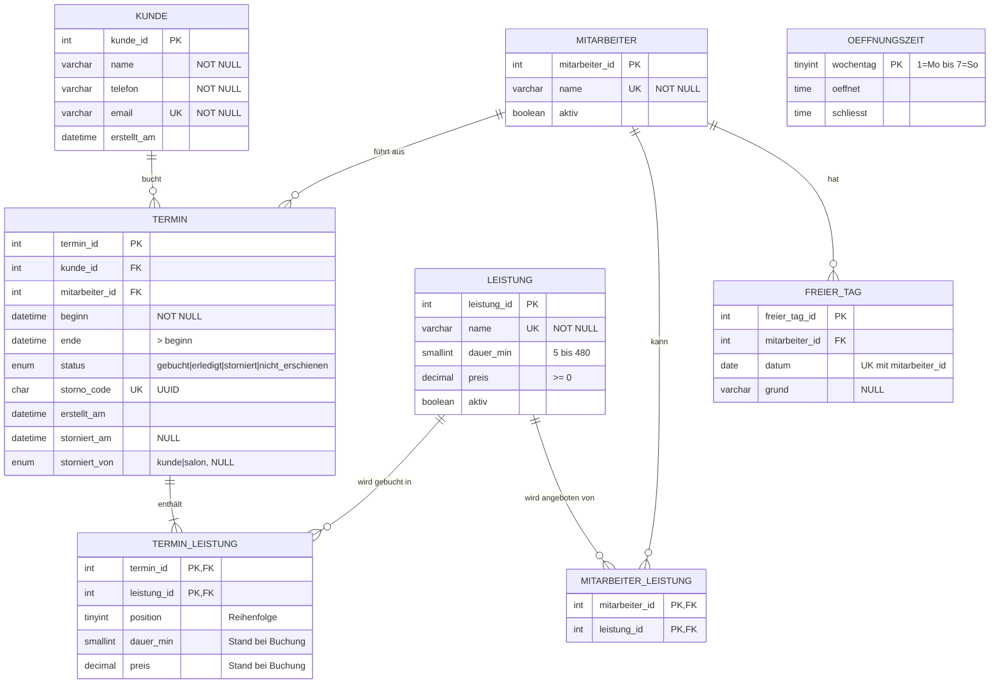

# ER-Diagramm

GitHub, GitLab und VS Code (mit Mermaid-Unterstützung) stellen das Diagramm direkt dar.
Eine Kopie steht in der README.

## Beziehungen

| Beziehung | Kardinalität | Umsetzung |
|---|---|---|
| Kunde – Termin | 1 : n (ein Kunde hat beliebig viele Termine, ein Termin genau einen Kunden) | `termin.kunde_id` FK |
| Mitarbeiter – Termin | 1 : n | `termin.mitarbeiter_id` FK |
| Mitarbeiter – Leistung | n : m („wer welche Leistung macht“) | Zuordnungstabelle `mitarbeiter_leistung` |
| Termin – Leistung | n : m (Bonus: Schnitt und Bart in einem Termin) | Zuordnungstabelle `termin_leistung` |
| Mitarbeiter – Freier Tag | 1 : n | `freier_tag.mitarbeiter_id` FK |
| Öffnungszeit | eigenständig (Stammdaten) | – |

## Normalisierung

* **1. NF:** Jede Zelle enthält genau einen Wert. Mehrere Leistungen pro Termin stehen als eigene
  Zeilen in `termin_leistung`, nicht als Liste in `termin`.
* **2. NF:** In den Tabellen mit zusammengesetztem Schlüssel (`mitarbeiter_leistung`,
  `termin_leistung`) hängt kein Attribut nur von einem Teil des Schlüssels ab. Der Name der
  Leistung steht nur in `leistung`.
* **3. NF:** Kundendaten stehen nur in `kunde`, im Termin bleibt nur `kunde_id`.
* **Bewusste Abweichung:** `termin_leistung.preis` und `dauer_min` wiederholen Werte aus
  `leistung`. Das ist Absicht: Sie halten den Stand zum Buchungszeitpunkt fest, damit eine
  Preisänderung bereits gebuchte Termine und die Umsatzauswertung nicht verändert.
  `termin.ende` ist aus `beginn` und der Dauer ableitbar, wird aber gespeichert, damit die
  Überschneidungsprüfung eine einfache, indizierbare Abfrage bleibt.
