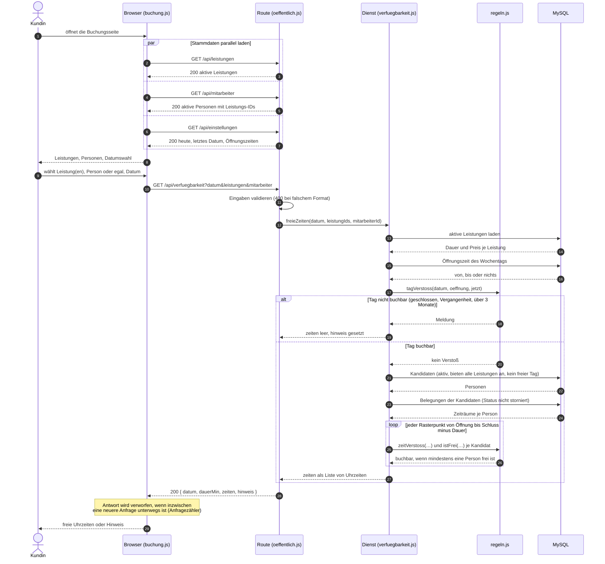
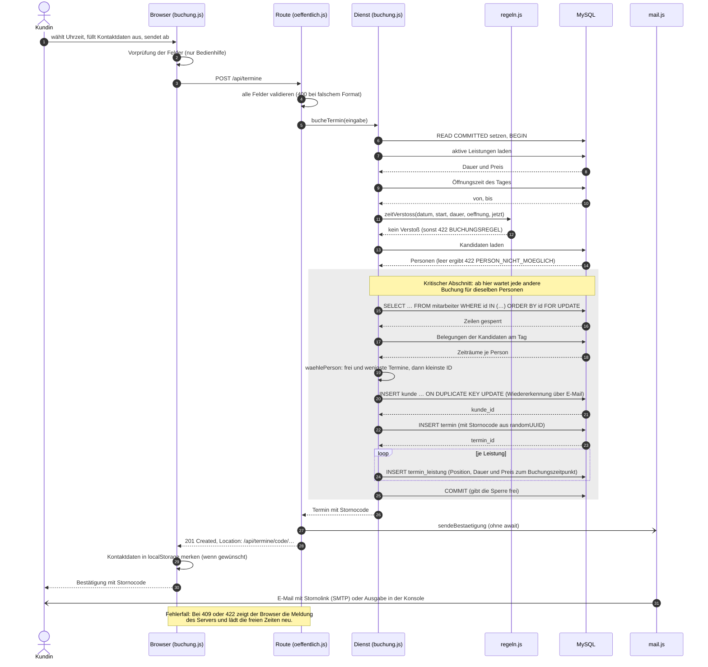
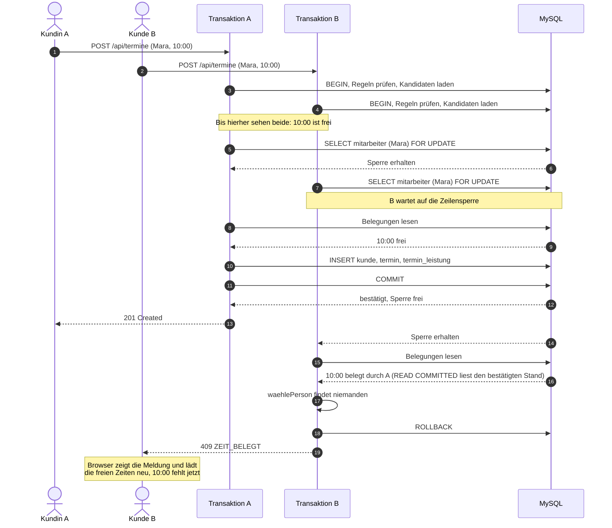
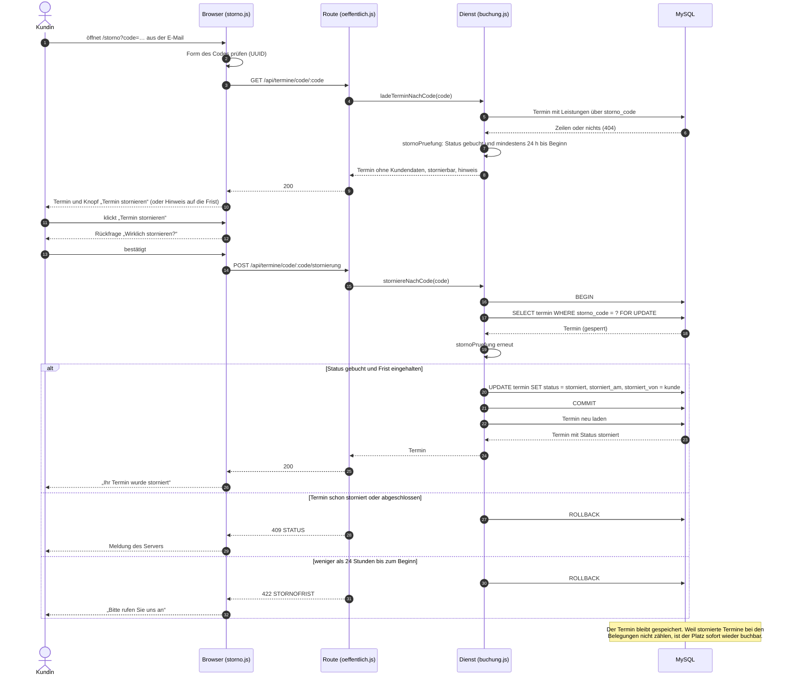
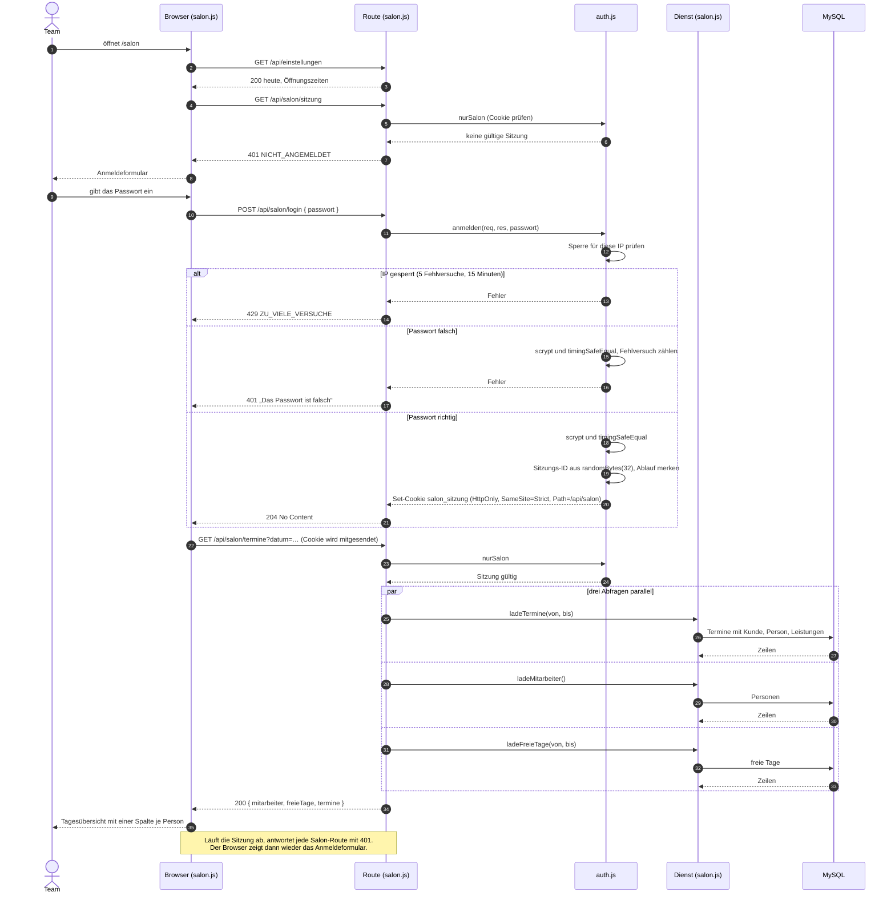
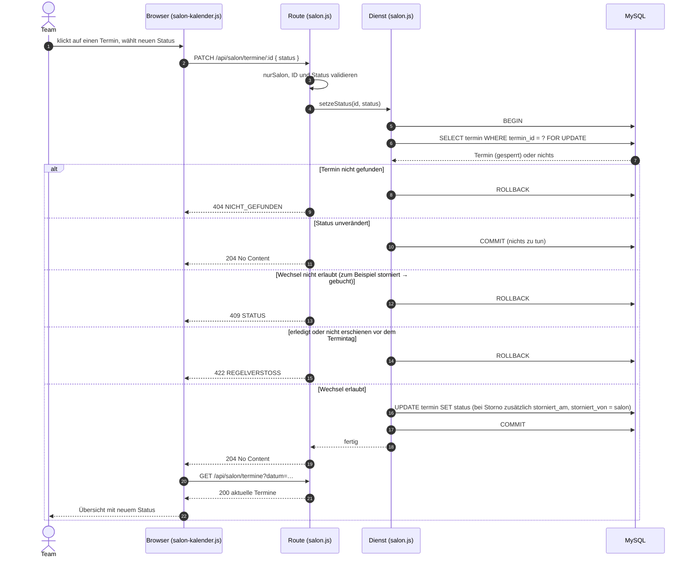
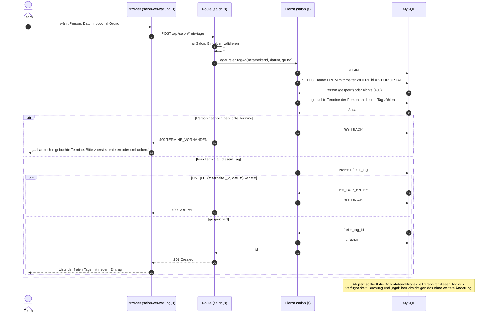

# Sequenzdiagramme

Die Diagramme zeigen die wichtigsten Abläufe der Anwendung so, wie sie im Code stehen.
GitHub, GitLab und VS Code (mit Mermaid-Unterstützung) stellen sie direkt dar.
Die Begründung der Entscheidungen dahinter steht in [architektur.md](architektur.md).

| Nr. | Ablauf | Code |
|---|---|---|
| 1 | [Buchungsseite laden und freie Zeiten anzeigen](#1-buchungsseite-laden-und-freie-zeiten-anzeigen) | `public/js/buchung.js`, `services/verfuegbarkeit.js` |
| 2 | [Termin buchen](#2-termin-buchen) | `routes/oeffentlich.js`, `services/buchung.js` |
| 3 | [Zwei gleichzeitige Buchungen auf denselben Platz](#3-zwei-gleichzeitige-buchungen-auf-denselben-platz) | `services/buchung.js`, `db.js` |
| 4 | [Termin per Stornocode stornieren](#4-termin-per-stornocode-stornieren) | `public/js/storno.js`, `services/buchung.js` |
| 5 | [Anmeldung im Salon-Bereich und Tagesübersicht](#5-anmeldung-im-salon-bereich-und-tagesübersicht) | `middleware/auth.js`, `routes/salon.js` |
| 6 | [Status eines Termins im Salon ändern](#6-status-eines-termins-im-salon-ändern) | `services/salon.js` |
| 7 | [Freien Tag eintragen](#7-freien-tag-eintragen) | `services/salon.js` |

Beteiligte in allen Diagrammen:

* **Browser** – die jeweilige Seite (`buchung.js`, `storno.js`, `salon*.js`) über `api.js`
* **Route** – Express-Router mit Validierung (`utils/validierung.js`)
* **Dienst** – Fachlogik in `services/`
* **MySQL** – Datenbank über `mysql2` (Pool oder Verbindung einer Transaktion)

---

## 1. Buchungsseite laden und freie Zeiten anzeigen

Beim Start lädt die Seite die Stammdaten parallel. Sobald Leistung und Datum gewählt sind,
fragt sie die freien Zeiten ab. Der Server liefert nur Uhrzeiten, keine Termine.

## 2. Termin buchen

Der Erfolgsfall mit allen Prüfungen. Prüfen und Speichern liegen in einer Transaktion;
die E-Mail wird erst nach dem Commit ausgelöst und hält die Antwort nicht auf.

## 3. Zwei gleichzeitige Buchungen auf denselben Platz

Beide Kundinnen sehen 10:00 Uhr bei Mara als frei und senden gleichzeitig ab.
Die Sperre auf der Mitarbeiter-Zeile sorgt dafür, dass die zweite Transaktion wartet und
danach den Termin der ersten sieht.

Bei „egal“ sperrt jede Transaktion alle Kandidaten in aufsteigender ID-Reihenfolge. Kunde B
bekäme dann nach dem Warten die nächste freie Person zugeteilt und ebenfalls 201. Die feste
Reihenfolge verhindert, dass sich zwei Transaktionen gegenseitig blockieren.

## 4. Termin per Stornocode stornieren

Die Stornoseite braucht keine Anmeldung. Sie zeigt nur Daten des eigenen Termins.
Das Stornieren ist zweistufig, und der Server prüft die Frist unter einer Zeilensperre erneut.

## 5. Anmeldung im Salon-Bereich und Tagesübersicht

Die Sitzung liegt im Arbeitsspeicher des Servers, der Browser hält nur eine zufällige ID in
einem `HttpOnly`-Cookie. Jede geschützte Route läuft durch die Middleware `nurSalon`.

## 6. Status eines Termins im Salon ändern

Erlaubte Wechsel: `gebucht` → `erledigt`, `nicht_erschienen`, `storniert`; `erledigt` und
`nicht_erschienen` lassen sich zurücksetzen; `storniert` ist endgültig.

Die Zeilensperre sorgt dafür, dass eine gleichzeitige Stornierung durch die Kundin (Diagramm 4)
und ein Statuswechsel im Salon nacheinander ablaufen. Wer zuerst kommt, gewinnt; die zweite
Anfrage sieht den neuen Status und bekommt 409.

## 7. Freien Tag eintragen

Ein freier Tag darf nur eingetragen werden, wenn die Person an dem Tag keine gebuchten Termine
hat. Die Transaktion sperrt dieselbe Mitarbeiter-Zeile wie die Buchung (Diagramm 2), sodass
beide Vorgänge nicht gleichzeitig im kritischen Abschnitt sein können.

