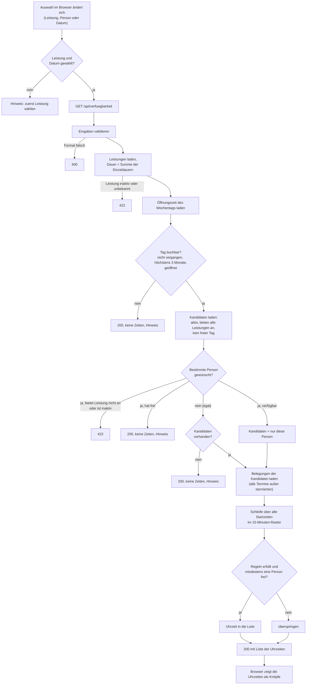

# Berechnung der freien Uhrzeiten

Dieses Dokument beschreibt, wie die Uhrzeiten entstehen, die auf der Buchungsseite zur Auswahl
stehen: vom Klick im Browser über die Berechnung im Backend bis zur erneuten Prüfung beim Buchen.

## Kurzfassung

* Die freien Uhrzeiten werden **vollständig im Backend** berechnet
  (`src/services/verfuegbarkeit.js`). Das Frontend zeigt nur die Liste an, die es bekommt.
* Eine Uhrzeit ist frei, wenn sie **alle Buchungsregeln** erfüllt und **mindestens eine passende
  Person** in dem Zeitraum keinen Termin hat.
* Die Liste ist eine **Momentaufnahme**. Verbindlich ist erst die Buchung, die alles unter einer
  Sperre noch einmal prüft.

```
frei(Start) =  Start liegt im 15-Minuten-Raster
           UND Start + Dauer passt in die Öffnungszeit
           UND Start liegt mindestens 2 Stunden in der Zukunft
           UND mindestens eine Kandidatin hat in [Start, Start + Dauer) keinen Termin
```

## Ablauf im Überblick



---

## 1. Frontend: wann und womit gefragt wird

Code: `public/js/buchung.js`, Funktion `ladeZeiten()`.

### Auslöser

Die freien Zeiten werden bei **jeder Änderung der Auswahl** neu geladen:

| Aktion | Funktion |
|---|---|
| Leistung an- oder abwählen | `toggleLeistung()` |
| Person oder „Egal“ wählen | `waehlePerson()` |
| Datum wählen oder mit den Pfeilen blättern | `waehleDatum()` |
| Buchung wurde mit 409 oder 422 abgelehnt | `sendeBuchung()` |

Ohne gewählte Leistung wird nicht gefragt. Eine bereits gewählte Uhrzeit wird bei jedem Neuladen
verworfen, weil sie zur neuen Auswahl nicht mehr passen muss.

### Was das Frontend selbst eingrenzt

Das sind Bedienhilfen, keine Regeln. Sie stammen aus `GET /api/einstellungen` und
`GET /api/mitarbeiter`:

* **Datum:** Das Datumsfeld lässt nur `heute` bis `letztesDatum` (heute + 3 Monate) zu. Die
  Pfeile springen direkt zum nächsten Öffnungstag. Vorbelegt ist heute oder der nächste
  Öffnungstag.
* **Person:** Wer nicht alle gewählten Leistungen anbietet, ist ausgegraut. Passt die gewählte
  Person nach einer Änderung der Leistungen nicht mehr, springt die Auswahl auf „Egal“ zurück.
* **Anzahl Leistungen:** höchstens drei.

Wird ein geschlossener Tag von Hand ins Datumsfeld eingetragen, fragt das Frontend trotzdem an
und zeigt den Hinweis des Servers.

### Veraltete Antworten

Bei schnellem Klicken sind mehrere Anfragen gleichzeitig unterwegs. Jede Anfrage bekommt eine
laufende Nummer (`zustand.anfrageNr`). Kommt eine Antwort an, deren Nummer nicht mehr die neueste
ist, wird sie verworfen. So kann eine langsame alte Antwort die aktuelle Liste nicht überschreiben.

## 2. Die Anfrage

```
GET /api/verfuegbarkeit?datum=2026-11-24&leistungen=1,5&mitarbeiter=egal
```

| Parameter | Bedeutung | Prüfung |
|---|---|---|
| `datum` | Tag im Format `YYYY-MM-DD` | muss ein echtes Kalenderdatum sein |
| `leistungen` | ein bis drei Leistungs-IDs, durch Komma getrennt | positive Ganzzahlen, keine doppelten |
| `mitarbeiter` | ID der Person oder `egal` (auch leer) | positive Ganzzahl oder `egal` |

Antwort:

```json
{
  "datum": "2026-11-24",
  "dauerMin": 45,
  "zeiten": ["09:00", "09:15", "09:30"],
  "hinweis": null
}
```

`zeiten` enthält nur Startzeiten. Die Antwort enthält weder Termine noch Namen und auch nicht,
*welche* Person frei ist. `hinweis` ist gesetzt, wenn die Liste leer ist, und erklärt den Grund.
Die Antwort trägt `Cache-Control: no-store` und wird nirgends zwischengespeichert.

## 3. Berechnung im Backend

Code: `freieZeiten()` in `src/services/verfuegbarkeit.js`. Die Regeln selbst stehen in
`src/services/regeln.js`, die Zahlenwerte in `src/config.js`.

### Schritt 1: Dauer bestimmen

Die gewählten Leistungen werden geladen. Die Dauer des Termins ist die **Summe** der
Einzeldauern, zum Beispiel Herrenschnitt (30) + Bartpflege (15) = 45 Minuten. Ist eine Leistung
unbekannt oder deaktiviert, endet die Anfrage mit 422.

### Schritt 2: Tag prüfen

`regeln.tagVerstoss()` prüft, ob an dem Tag überhaupt gebucht werden kann. Schlägt eine Prüfung
fehl, kommt eine leere Liste mit Hinweis zurück:

| Prüfung | Hinweis |
|---|---|
| Datum liegt vor heute | „Das Datum liegt in der Vergangenheit.“ |
| Datum liegt mehr als 3 Monate voraus | „Termine können höchstens 3 Monate im Voraus gebucht werden …“ |
| Für den Wochentag gibt es keine Öffnungszeit | „An diesem Tag ist der Salon geschlossen …“ |

Die Öffnungszeiten stehen in der Tabelle `oeffnungszeit`: Dienstag bis Freitag 9:00–18:00 Uhr,
Samstag 9:00–14:00 Uhr. Sonntag und Montag haben keinen Eintrag.

### Schritt 3: Kandidaten bestimmen

`stammdaten.ladeKandidaten()` liefert die Personen, die den Termin übernehmen könnten.
Eine Person ist Kandidatin, wenn sie

1. aktiv ist,
2. **alle** gewählten Leistungen anbietet (Tabelle `mitarbeiter_leistung`) und
3. an dem Tag keinen freien Tag eingetragen hat (Tabelle `freier_tag`).

Danach wird die Personenwahl berücksichtigt:

| Wahl | Ergebnis |
|---|---|
| „Egal“ | alle Kandidaten bleiben im Rennen |
| bestimmte Person, ist Kandidatin | nur diese Person wird betrachtet |
| bestimmte Person hat frei | leere Liste, Hinweis „… hat an diesem Tag frei“ |
| bestimmte Person bietet die Leistung nicht an oder ist inaktiv | 422 |
| kein Kandidat übrig | leere Liste, Hinweis „… niemand für diese Leistung im Salon“ |

### Schritt 4: Belegungen laden

`ladeBelegungen()` holt mit **einer** Abfrage alle Termine der Kandidaten, die den Tag berühren:

```sql
SELECT mitarbeiter_id, beginn, ende
  FROM termin
 WHERE mitarbeiter_id IN (…)
   AND status <> 'storniert'
   AND beginn < :tagesende AND ende > :tagesbeginn
```

Daraus entsteht pro Person eine Liste belegter Zeiträume. **Stornierte Termine zählen nicht**,
ihr Platz ist sofort wieder frei. Termine mit Status `gebucht`, `erledigt` und
`nicht_erschienen` belegen ihre Zeit.

### Schritt 5: Raster durchlaufen

Jetzt wird jede mögliche Startzeit geprüft, von der Öffnung bis zum letzten Beginn, bei dem der
Termin noch vor Ladenschluss endet (vereinfachter Auszug):

```js
for (start = oeffnung.von; start + dauerMin <= oeffnung.bis; start += 15) {
  if (regeln.zeitVerstoss(datum, start, dauerMin, oeffnung, jetzt)) continue;
  const jemandFrei = kandidaten.some((k) => regeln.istFrei(belegungen.get(k.id), beginn, ende));
  if (jemandFrei) zeiten.push(start);
}
```

Für jede Startzeit gelten zwei Bedingungen.

**a) Die Zeitregeln sind erfüllt** (`regeln.zeitVerstoss`):

| Regel | Bedingung | Wert |
|---|---|---|
| Raster | Start ist ein Vielfaches von 15 Minuten | `rasterMin: 15` |
| Öffnungszeit | Start ≥ Öffnung und Start + Dauer ≤ Schluss | Tabelle `oeffnungszeit` |
| Vergangenheit | Start liegt nach dem aktuellen Zeitpunkt | Serverzeit in Salon-Zeitzone |
| Vorlauf | Start liegt mindestens 2 Stunden in der Zukunft | `minVorlaufMin: 120` |

Genau 2 Stunden Vorlauf sind noch erlaubt. Der Vorlauf wirkt sich nur auf den heutigen Tag aus:
Um 10:00 Uhr ist die erste buchbare Zeit heute 12:00 Uhr.

**b) Mindestens eine Kandidatin ist frei** (`regeln.istFrei`). Eine Person ist frei, wenn sich
der gewünschte Zeitraum mit keiner ihrer Belegungen überschneidet. Zwei Zeiträume überschneiden
sich, wenn

```
beginn_neu < ende_alt  UND  ende_neu > beginn_alt
```

Ein Termin, der genau dann beginnt, wenn der vorige endet, überschneidet sich also **nicht**.

Bleibt die Liste am Schluss leer, lautet der Hinweis „An diesem Tag ist leider keine passende
Zeit mehr frei“.

## 4. Was „Egal“ bedeutet

Bei „Egal“ erscheint eine Uhrzeit, sobald **irgendeine** Kandidatin frei ist. Die Liste ist die
Vereinigung der freien Zeiten aller Kandidaten. Wer den Termin tatsächlich bekommt, entscheidet
sich erst beim Buchen: die freie Person mit den wenigsten Terminen an diesem Tag, bei Gleichstand
die mit der kleineren ID (`waehlePerson()` in `src/services/buchung.js`).

## 5. Besonderheiten

**Dauer, die nicht ins Raster passt.** Der Kinderschnitt dauert 20 Minuten. Der **Beginn** liegt
immer im Raster, das **Ende** ergibt sich exakt aus der Dauer. Ein Termin 9:00–9:20 Uhr sperrt
die Startzeit 9:15 (Überschneidung), ab 9:30 ist die Person wieder buchbar. Zwischen 9:20 und
9:30 bleibt sie ungenutzt.

**Mehr als die Startzeit fällt weg.** Ein gebuchter Termin entfernt auch frühere Startzeiten,
deren Termin in ihn hineinragen würde. Ist 11:00–11:45 Uhr belegt, fällt für einen
30-Minuten-Termin auch 10:45 weg (würde bis 11:15 dauern). 10:30 bleibt frei.

**Lange Termine am Nachmittag.** Je länger der Termin, desto früher die letzte Startzeit: Färben
(90 Minuten) kann an einem Tag bis 18:00 Uhr spätestens um 16:30 beginnen, samstags um 12:30.

**Keine Pausen, kein Puffer.** Zwischen zwei Terminen wird keine Rüstzeit eingeplant, und es gibt
keine festen Pausen. Abwesenheiten werden nur als ganze freie Tage erfasst.

**Zeitrechnung.** Gerechnet wird mit ganzen Minuten in lokaler Salonzeit (`Europe/Berlin`), ohne
Umrechnung über Zeitzonen (`src/utils/zeit.js`). „Jetzt“ ist immer die Uhr des Servers, nie die
des Browsers.

## 6. Rechenbeispiel

Ausgangslage sind die Beispieldaten aus `db/schema.sql`: der Beispiel-Dienstag, Öffnung
9:00–18:00 Uhr. Gesucht wird **Färben (90 Minuten), Person „Egal“**. Der Tag liegt mehr als
2 Stunden in der Zukunft, der Vorlauf spielt also keine Rolle.

**Kandidaten:** Sabine und Mara. Jonas bietet Färben nicht an und scheidet aus.

**Belegungen:**

| Person | belegt | freie Lücken |
|---|---|---|
| Sabine | 09:30–10:15, 13:00–13:45, 16:00–17:30 | 09:00–09:30, 10:15–13:00, 13:45–16:00, 17:30–18:00 |
| Mara | 09:00–10:30, 10:30–12:00, 14:00–14:30 | 12:00–14:00, 14:30–18:00 |

**Mögliche Startzeiten:** 09:00 bis 16:30 im 15-Minuten-Raster. In eine Lücke passt ein Start,
wenn Start + 90 Minuten noch in der Lücke liegt und der Start im Raster liegt:

| Lücke | Länge | Startzeiten für 90 Minuten |
|---|---|---|
| Sabine 09:00–09:30 | 30 Min | keine (zu kurz) |
| Sabine 10:15–13:00 | 165 Min | 10:15 bis 11:30 |
| Sabine 13:45–16:00 | 135 Min | 13:45 bis 14:30 |
| Sabine 17:30–18:00 | 30 Min | keine (zu kurz) |
| Mara 12:00–14:00 | 120 Min | 12:00 bis 12:30 |
| Mara 14:30–18:00 | 210 Min | 14:30 bis 16:30 |

**Ergebnis** (Vereinigung beider Personen, 21 Uhrzeiten):

```
10:15 10:30 10:45 11:00 11:15 11:30
12:00 12:15 12:30
13:45 14:00 14:15 14:30 14:45 15:00 15:15 15:30 15:45 16:00 16:15 16:30
```

Nicht angeboten werden zum Beispiel:

| Uhrzeit | Grund |
|---|---|
| 09:00 | Sabine ab 09:30 belegt, Mara belegt |
| 11:45 | Sabine wäre bis 13:15 beschäftigt, hat aber um 13:00 einen Termin. Mara ist bis 12:00 belegt. |
| 12:45 | Sabine ab 13:00 belegt. Mara wäre bis 14:15 beschäftigt, hat aber um 14:00 einen Termin. |
| 16:45 | Termin würde bis 18:15 dauern, der Salon schließt um 18:00 |

Der automatische Test „F-02/N-02: freie Zeiten sind nur Uhrzeiten“ in `tests/api.test.js` prüft
genau diesen Fall: erste Zeit 10:15, letzte Zeit 16:30, 12:45 nicht enthalten.

## 7. Von der Anzeige zur Buchung

Zwischen Anzeige und Absenden können Sekunden oder Minuten liegen. In dieser Zeit kann jemand
anderes den Platz buchen, oder die 2-Stunden-Grenze wird überschritten. Deshalb prüft
`bucheTermin()` alles noch einmal:

| | Anzeige (`freieZeiten`) | Buchung (`bucheTermin`) |
|---|---|---|
| Zeitregeln | `regeln.zeitVerstoss` | dieselbe Funktion |
| Kandidaten | `ladeKandidaten` | dieselbe Funktion |
| Belegungen | `ladeBelegungen` | dieselbe Funktion |
| Frei-Prüfung | `regeln.istFrei` | dieselbe Funktion |
| Sperre | keine, reine Leseabfrage | Transaktion mit `SELECT … FOR UPDATE` auf die Mitarbeiter-Zeilen |

Weil beide Wege dieselben Funktionen benutzen, kann eine angezeigte Zeit nicht aus einem anderen
Grund abgelehnt werden als dem, dass sich die Lage inzwischen geändert hat. In dem Fall antwortet
der Server mit 409 (Platz vergeben) oder 422 (Regel jetzt verletzt), und das Frontend lädt die
freien Zeiten sofort neu. Die Uhrzeit, die es nicht mehr gibt, verschwindet aus der Liste.

Mehr dazu: [Sequenzdiagramme 1 bis 3](sequenzdiagramme.md) und
[architektur.md, Abschnitte 3 bis 5](architektur.md#3-eine-regel-zwei-verwendungen).

## 8. Wo was steht

| Thema | Datei |
|---|---|
| Auslöser, Anfragezähler, Anzeige der Knöpfe | `public/js/buchung.js` (`ladeZeiten`, `zeigeZeiten`) |
| Aufruf der Route | `public/js/api.js` (`ladeFreieZeiten`) |
| Route und Validierung | `src/routes/oeffentlich.js`, `src/utils/validierung.js` |
| Berechnung | `src/services/verfuegbarkeit.js` (`freieZeiten`, `ladeBelegungen`) |
| Regeln und Überschneidung | `src/services/regeln.js` |
| Kandidaten, Öffnungszeit, Leistungen | `src/services/stammdaten.js` |
| Zahlenwerte (Raster, Vorlauf, 3 Monate) | `src/config.js` |
| Zeitrechnung | `src/utils/zeit.js` |
